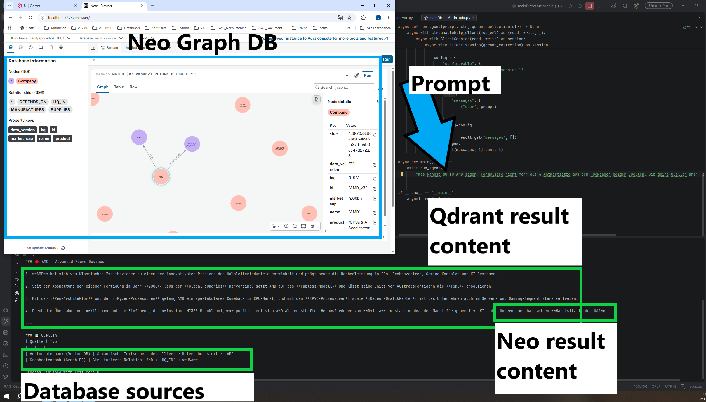

Features:

    1. Use Neo graph db and qdrant vector db

    2. Apply a hybrid search onto Qdrant, merge Qdrant and Neo results, rerank both results 

    3  Use Langgraph 

    4. Use LLM  Anthropic 

    5. Call MCP tools at most 3 times 

***PREREQUISITES***

!!! Configure your .env file !!! => Use .env.example as template!

=> ANTHROPIC_API_KEY, AWS_PROFILE ( if AWS Bedrock and Guardrails is used ) , LANGFUSE_SECRET_KEY and LANGFUSE_PUBLIC_KEY 

USE CASE 1 : Based on the MCP tool result from VectorDB (Qdrant) and a GraphDB (Neo) Anthropic LLM creates an answer   

**--------------------------------------------------------------------------------------------------------------------**

<figure>
  
  <figcaption>LLM query processsing using GraphDB and Vector DB sources.</figcaption>
</figure>

*1.1 Start and ingest VECTOR  database* 

docker run --name ai-agent-qdrant -p 6333:6333 -p 6334:6334 qdrant/qdrant

Add document to Qdrant  ( create Chunks, Embeddings ):

uv run python -m qdrant_data_importer

[ Check content via dashboard: http://localhost:6333/dashboard#/collections ]

*1.2 Start and ingest GRAPH database*

docker run \
    -p 7474:7474 -p 7687:7687 \
    -v /c/Daten/IT/DEV/Python/RAG_Research/data:/var/lib/neo4j/import \
    --name neo4j \
    -e NEO4J_PLUGINS='["apoc"]' \
    -e NEO4J_AUTH=neo4j/password \
    neo4j:latest

UI: http://localhost:7474/browser/

ingest graph-native document 'graphdb_semiconductor.txt' :

uv run python -m neo_data_importer

*2. Start MCP server*

uv run python -mcp_server

*3. Retrieve AMD-related subset of ingested content*

run ./scripts/start.sh  (   for AWS Bedrock usage set AWS_REGION & AWS_PROFILE
                            for Claude usage set ANTHROPIC_API_KEY )
uv run python -m mainGraphDB

Result:
"""
### 🔴 AMD – Advanced Micro Devices

1. **AMD** hat sich vom klassischen Zweitbezieher zu einem der innovativsten Pioniere der Halbleiterindustrie entwickelt und prägt heute die Rechenleistung in PCs, Rechenzentren, Gaming-Konsolen und KI-Systemen.

2. Seit der Abspaltung der eigenen Fertigung im Jahr **2008** (aus der **GlobalFoundries** hervorging) setzt AMD auf das **Fabless-Modell** und lässt seine Chips von Auftragsfertigern wie **TSMC** produzieren.

3. Mit der **Zen-Architektur** und den **Ryzen-Prozessoren** gelang AMD ein spektakuläres Comeback im CPU-Markt, und mit den **EPYC-Prozessoren** sowie **Radeon-Grafikkarten** ist das Unternehmen auch im Server- und Gaming-Segment stark vertreten.

4. Durch die Übernahme von **Xilinx** und die Einführung der **Instinct MI300-Beschleuniger** positioniert sich AMD als ernsthafter Herausforderer von **Nvidia** im stark wachsenden Markt für generative KI – das Unternehmen hat seinen **Hauptsitz in den USA**.

---

### 📚 Quellen:
| Quelle | Typ |
|---|---|
| Vektordatenbank (Vector DB) | Semantische Textsuche – detaillierter Unternehmenstext zu AMD |
| Graphdatenbank (Graph DB) | Strukturierte Relation: AMD → `HQ_IN` → **USA** |
"""

**--------------------------------------------------------------------------------------------------------------------**

**--------------------------------------------------------------------------------------------------------------------**

**--------------------------------------------------------------------------------------------------------------------**

BACKGROUND

Einsatz von Graph DBs mittlerweile ein sehr verbreiteter und stark wachsender Trend, der oft als GraphRAG (Graph Retrieval-Augmented Generation) bezeichnet wird.

Während klassisches RAG hauptsächlich auf Vektordatenbanken (Vektorsuche über Text-Embeddings) setzt, 

lösen Graphendatenbanken (wie Neo4j, AWS Neptune oder ArangoDB) entscheidende Schwachstellen dieser Methode.

Warum werden Graphendatenbanken in RAG-Szenarien genutzt?

• Verknüpfung von Informationen: Vektorsuche findet hervorragend ähnliche Textabschnitte, ist aber blind für explizite Beziehungen. Graphen verknüpfen Entitäten (z. B. Person A -> arbeitet bei -> Firma B -> stellt her -> Produkt C).
• Multi-Hop-Anfragen: Fragen, die das Zusammenführen von Informationen über mehrere Ecken erfordern (z. B. „Welche CEOs von Tech-Firmen haben an derselben Universität studiert wie Gründer X?“), sind für reine Vektordatenbanken extrem schwer, für Graphen jedoch Standard.
• Ergebnis-Kontext und Explainability: Graphen bieten eine klare Struktur. Man kann der KI genau vorgeben, welche Pfade sie im Graphen ablaufen soll. Das reduziert Halluzinationen und macht die Antwort nachvollziehbar.

Wie sieht die Kombination in der Praxis aus?

In modernen Enterprise-Architekturen nutzt man meist einen hybriden Ansatz:
1. Vektorsuche (Unstrukturierter Text): Für das Finden von semantisch relevanten Dokumenten oder Abschnitten.
2. Graphsuche (Strukturierte Beziehungen): Für das Abfragen von Fakten, Hierarchien und Netzwerken.
3. Kombination: Das LLM erhält sowohl die Textfragmente als auch die extrahierten Graphen-Zusammenhänge (oft als Wissensgraph / Knowledge Graph), um die finale Antwort zu generieren. Frameworks wie LangChain, LlamaIndex oder Microsofts eigenes GraphRAG-Repository bieten dafür standardisierte Implementierungen.

**--------------------------------------------------------------------------------------------------------------------**

**--------------------------------------------------------------------------------------------------------------------**

**--------------------------------------------------------------------------------------------------------------------**

SANDBOX

*delete whole Neo content
MATCH (n) DETACH DELETE n )

